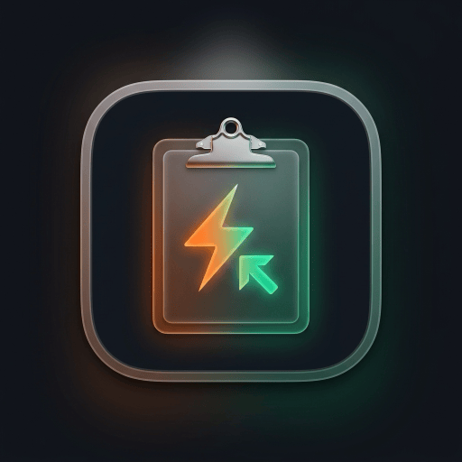
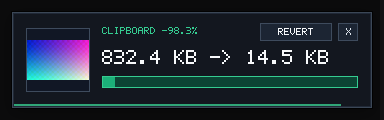

<p align="center">
  
</p>

<h1 align="center">clop-rs ⚡</h1>

<p align="center">
  A minimal-footprint, cross-platform (<strong>macOS</strong> &amp; <strong>Windows</strong>) automatic clipboard &amp; downloads image optimizer written in pure <strong>Rust</strong>, inspired by <a href="https://github.com/FuzzyIdeas/Clop">FuzzyIdeas/Clop</a>.
</p>

Whenever you copy an image or screenshot to your clipboard, `clop-rs` silently optimizes it in-place in milliseconds (typically **60–85% smaller**) so you can immediately paste tiny, fast-loading images into Slack, Discord, GitHub, Notion, browsers, or emails.

---

## UI Preview

<p align="center">
  
</p>

The non-intrusive **Floating HUD Panel** appears in the bottom-right corner whenever an image is optimized, displaying a 64×64 thumbnail preview, exact Before → After size and savings percentage, an `[EXIF]` badge when metadata is stripped, a live progress bar, and a one-click **`[REVERT]`** button.

---

## Key Features

- **Floating HUD Panel (Like Clop)**:
  - Automatically pops up a sleek, non-intrusive floating HUD panel in the bottom-right corner whenever an image is optimized.
  - Shows a **live progress bar** during optimization, a **64×64 thumbnail preview**, the exact **Before → After size & percentage saved** (e.g. `445.7 KB -> 103.7 KB (-76.7%)`), an **`[EXIF]`** badge when metadata is stripped, and a one-click **`[REVERT]`** button to immediately restore the original unoptimized image.
- **One-Click Revert**:
  - Click **`[REVERT]`** right on the floating HUD panel (or **"Revert Last Optimization"** in the Menu Bar / System Tray menu) to restore the original unoptimized image back to the clipboard or Downloads folder.
- **Right-Click "Optimize with clop-rs" Context Menu**:
  - Right-click any **Image, Video, or PDF** file in **macOS Finder** (*Quick Actions / Services → Optimize with clop-rs*) or **Windows Explorer** (*Optimize with clop-rs*) to optimize it on the spot with the Floating HUD Panel and one-click **`[REVERT]`**.
  - Can be toggled on/off in the Menu Bar / System Tray or via `clop-rs context-menu --enable` / `--disable`.
- **Video & Screen Recording Optimization (FFmpeg)**:
  - Compresses `.mp4`, `.mov`, `.mkv`, `.webm`, `.m4v`, and `.avi` videos using hardware-accelerated H.264 (`h264_videotoolbox` on macOS) or `libx264` CRF encoding, strips video metadata, and shows a video frame preview in the Floating HUD Panel.
- **PDF Compression**:
  - Built-in pure-Rust PDF stream optimizer (re-compresses `/FlateDecode` streams, optimizes embedded `/DCTDecode` JPEG images, strips XMP metadata bloat, and rebuilds the `xref` table) + automatic Ghostscript (`gs`) integration when available.
- **Automatic Downloads Folder Optimization**:
  - Toggle **"Auto-Optimize Downloads Folder"** in the Menu Bar / System Tray (or pass `--watch-downloads`) to automatically optimize newly downloaded **Images, Videos, and PDFs** in `~/Downloads`.
- **EXIF & Metadata Stripping**:
  - Toggle **"Strip EXIF & Metadata"** in the Menu Bar / System Tray (or `--strip-exif` / `--keep-exif` on the CLI) to strip camera EXIF, GPS coordinates, XMP/IPTC, and PNG text/time chunks.
- **Cross-Platform (macOS & Windows) & Ultra-Minimal Footprint**:
  - Uses O(1) OS clipboard sequence counters (`NSPasteboard.changeCount` on macOS, `GetClipboardSequenceNumber()` on Windows) for **0% idle CPU** and **~2.1 MB** standalone binary size.
- **Direct Native PNG Clipboard Preservation**:
  - Writes the exact compressed PNG stream directly to `public.png` on macOS and the registered `PNG` clipboard format (alongside `CF_DIBV5`) on Windows, so pasting apps receive the exact quantized + deflate-optimized PNG bytes without re-encoding.
- **Two Optimization Modes**:
  - **Smart Mode (Default)**: Uses `imagequant` (the engine behind `pngquant` and `Clop`) for perceptual 8-bit RGBA palette quantization followed by `oxipng` deflate compression (**60–85% size reduction** with virtually zero perceptual quality loss).
  - **Strict Lossless Mode (`--lossless`)**: Uses `oxipng` + `libdeflater` to strip metadata and optimize PNG deflate streams while preserving 100% bit-exact 32-bit RGBA pixel values.
- **Flexible Runtime Modes**:
  - **System Tray / Menu Bar App** (default): Lightweight tray menu to pause/resume, toggle Smart vs. Lossless mode, view live savings statistics, optimize on demand, or toggle Launch at Login.
  - **Headless Daemon (`--headless`)**: Pure background process with zero UI.
  - **One-Shot CLI (`--once` / `-1`)**: Optimize the current clipboard image once and exit (great for hotkeys, Raycast, Alfred, AutoHotkey, or PowerToys).
  - **File Optimizer (`clop-rs file <paths>`)**: Optimize PNG, JPEG, WebP, BMP, or TIFF files on disk.

---

## Installation & Build

### Option 1: Download Prebuilt Installer (Recommended)
Download the latest installer from [**GitHub Releases**](https://github.com/HamidRezaAshkiyan/clop-rs/releases/latest):

- **macOS (`.pkg` Installer)**: [`clop-rs-v0.3.0-macos-arm64.pkg`](https://github.com/HamidRezaAshkiyan/clop-rs/releases/latest/download/clop-rs-v0.3.0-macos-arm64.pkg) — Installs `/Applications/clop-rs.app`, `/usr/local/bin/clop-rs`, and the Finder Right-Click Quick Action.
- **macOS (`.dmg` Disk Image)**: [`clop-rs-v0.3.0-macos-arm64.dmg`](https://github.com/HamidRezaAshkiyan/clop-rs/releases/latest/download/clop-rs-v0.3.0-macos-arm64.dmg) — Drag-and-drop `clop-rs.app` to `Applications`.
- **Windows (`.exe` / `.zip`)**: [`clop-rs-v0.3.0-windows-x64.exe`](https://github.com/HamidRezaAshkiyan/clop-rs/releases/latest/download/clop-rs-v0.3.0-windows-x64.exe) / [`clop-rs-v0.3.0-windows-x64.zip`](https://github.com/HamidRezaAshkiyan/clop-rs/releases/latest/download/clop-rs-v0.3.0-windows-x64.zip)

### Option 2: One-Line Terminal Installer

**macOS**:
```bash
curl -fsSL https://github.com/HamidRezaAshkiyan/clop-rs/releases/latest/download/install.sh | bash
```

**Windows (PowerShell)**:
```powershell
irm https://github.com/HamidRezaAshkiyan/clop-rs/releases/latest/download/install.ps1 | iex
```

### Option 3: Build from Source

```bash
git clone https://github.com/HamidRezaAshkiyan/clop-rs.git
cd clop-rs
cargo build --release
```

The optimized binary will be generated at:
- **macOS**: `./target/release/clop-rs`
- **Windows**: `.\target\release\clop-rs.exe` (compiled with `windows_subsystem = "windows"` so no console window flashes when launched in the background)

---

## Usage

### 1. Run in Menu Bar / System Tray Mode (Default)
```bash
clop-rs

# Also auto-optimize newly downloaded images in ~/Downloads
clop-rs --watch-downloads

# Run in tray mode without the floating HUD panel
clop-rs --no-hud
```

### 2. Run as a Pure Headless Daemon
```bash
clop-rs --headless
```

### 3. Optimize the Current Clipboard Once and Exit
```bash
clop-rs --once
```

### 4. Strict Lossless Mode or Custom Quality / Downscaling
```bash
# Strict lossless mode (bit-exact pixels)
clop-rs --lossless

# Downscale Retina 2x screenshots by half and optimize
clop-rs --scale-factor 2.0

# Cap maximum image dimensions to 1920x1080
clop-rs --max-width 1920 --max-height 1080

# Custom perceptual quality target (10-100, default: 95)
clop-rs --quality 85
```

### 5. Optimize Image Files on Disk
```bash
# Optimize one or more files in-place
clop-rs file screenshot1.png screenshot2.png

# Optimize to a new output path
clop-rs file input.png --output output.png
```

### 6. Enable / Disable Launch at Login
```bash
# Enable auto-start (macOS LaunchAgent / Windows Startup)
clop-rs autostart --enable

# Disable auto-start
clop-rs autostart --disable
```

### 7. View or Save Persistent Configuration
Configuration is stored in:
- **macOS**: `~/Library/Application Support/clop-rs/config.toml`
- **Windows**: `%APPDATA%\clop-rs\config.toml`

```bash
# Print current effective configuration
clop-rs config

# Save CLI flags as persistent defaults
clop-rs --quality 90 --max-width 2560 config --save

# Reset configuration to defaults
clop-rs config --reset
```

---

## Architecture

```
┌───────────────────────────────────────────────────────────┐
│        OS Clipboard (macOS NSPasteboard / Win32)          │
└─────────────┬─────────────────────────────────┬───────────┘
              │ O(1) Sequence Counter Check     │
              ▼                                 │
┌───────────────────────────┐                   │
│  ClipboardMonitor         │                   │
│  • Change count guard     │                   │
│  • 64-bit hash ring-buf   │                   │
│    (prevents self-loops)  │                   │
└─────────────┬─────────────┘                   │
              │ New Unoptimized Image           │
              ▼                                 │
┌───────────────────────────┐                   │
│  Optimization Pipeline    │                   │
│  1. Lanczos3 Downscale    │                   │
│  2. imagequant Palette    │                   │
│  3. oxipng Libdeflater    │                   │
│  4. Strict Size Guard     │                   │
└─────────────┴─────────────────────────────────┘
              Writes raw `public.png` / `PNG`
```

---

## License

MIT License
